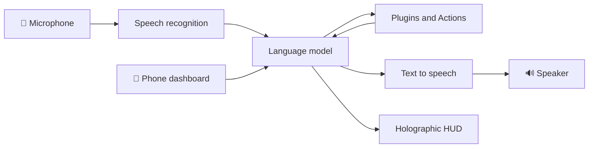

<div align="center">

# 🤖 MARK LIV

### A JARVIS-style voice assistant for your desktop. Talk to it, and it runs your computer.


<!-- [ADD SCREENSHOT / DEMO GIF] Record 15-30 seconds of the HUD responding and save it as docs/demo.gif -->

</div>

MARK LIV holds a real-time spoken conversation through the **Gemini Live API** and acts on what you say: browsing the web, controlling the OS, reading documents and running plugins. Its holographic HUD and 3D avatar head are drawn entirely in software, so it needs **no GPU and no OpenGL**.

---

## ⚡ Quick Start

### Prerequisites

- **Python 3.11 to 3.13** (3.13 is the highest tested version)
- **Git**
- A **free Gemini API key** from [Google AI Studio](https://aistudio.google.com/apikey)

### Windows (PowerShell)

```powershell
git clone https://github.com/ayushdere96-glitch/Jarvis-voice-assistant.git   # download the project
cd Jarvis-voice-assistant                                                    # enter the folder
python setup.py        # installs deps for YOUR OS + the browser automation engine
python main.py         # launch the assistant
```

### macOS / Linux

```bash
git clone https://github.com/ayushdere96-glitch/Jarvis-voice-assistant.git   # download the project
cd Jarvis-voice-assistant                                                    # enter the folder
python3 setup.py       # installs deps for YOUR OS + the browser automation engine
python3 main.py        # launch the assistant
```

### First run

1. Paste your **Gemini API key** when the setup screen appears.
2. Press the mic and start talking.
3. *(Optional)* Enable the **"Hey Jarvis"** wake word from **⚙ → WAKE WORD**. It is a one-click download and is not installed by default.

### Troubleshooting

| Problem | Fix |
|---|---|
| Wrong Python version | `setup.py` stops with a clear message below 3.11 and warns above 3.13. Install a supported version and run `py -3.11 setup.py` (Windows) or `python3.11 setup.py` (macOS/Linux). |
| Playwright download fails | Not fatal. Everything except browser automation still works. Retry later: `python -m playwright install chromium firefox` |
| `pywin32` not registered (Windows) | Run `python -m pip install --force-reinstall pywin32`, then the `pywin32_postinstall.py` command printed by `setup.py`. |
| Linux volume, brightness or reminders don't work | Install the native tools: `pulseaudio-utils` (pactl), `brightnessctl`, `systemd` or `at`, and `xdg-utils`. |
| No sound | Check the audio device pickers in the settings panel. The microphone runs at 16 kHz and the speaker at 24 kHz. |

---

## ✨ Features

| | Feature | Details |
|---|---|---|
| 🎙️ | **Real-time voice** | Live conversation through the Gemini Live API |
| 🧑‍🚀 | **Holographic HUD** | PyQt6 interface with a 3D avatar head rendered in software (QPainter + numpy) |
| 🔌 | **Plugin system** | Drop a `.py` file into `plugins/` and it is discovered at startup |
| 🧠 | **Bring your own models** | Local or cloud STT, LLM and TTS via a providers panel |
| 🌐 | **Browser automation** | Playwright (Chromium and Firefox) |
| 👁️ | **Screen and vision** | OpenCV and mss |
| 🖥️ | **OS control** | Volume, brightness and reminders on Windows, macOS and Linux |
| 📱 | **Phone dashboard** | FastAPI remote control with a QR code |
| 🗣️ | **Wake word** | Optional local "Hey Jarvis" (openwakeword) |
| ▶️ | **Video on the HUD** | Local files, direct URLs, and YouTube via yt-dlp |
| ⏰ | **Voice reminders** | Say what and when; reminders are scheduled with native OS tools on Windows, macOS and Linux |
| 💬 | **Hands-free messaging** | Give a command and it sends the message for you (WhatsApp plugins drive the desktop app on Windows) |
| 🧠 | **Persistent memory** | Remembers your settings and details between sessions, stored locally in `memory/` |
| 🌍 | **Speaks many languages** | Understands about 50 languages and replies in the language you spoke, with local or cloud voices |

---

## 🗣️ Try these commands

| Say | What happens |
|---|---|
| "Remind me to submit the assignment at 6 PM" | Schedules a reminder with your OS |
| "Send a message to Rahul saying I'll be late" | Finds the contact and sends it for you |
| "Remember that my exam is on Friday" | Saves it to memory for later sessions |
| "Open YouTube and play lo-fi music" | Browser automation and HUD video |
| "Check my calendar for today" | Gmail / Calendar plugin (after OAuth setup) |
| Speak in Hindi, Spanish, French... | Jarvis detects the language and answers in it |

> These are example phrases. The assistant picks tools from their descriptions, so natural wording works.

## 🌍 Multilingual voice

People switch languages mid-conversation, so the voice pipeline is built for it:

- **Hearing:** local Whisper recognizes about 50 languages and detects the language per sentence. Nothing needs to be configured.
- **Speaking, local:** Piper picks the voice that matches the language it just heard you speak (about 50 languages, around 60 MB per voice, downloaded on demand).
- **Speaking, cloud:** one ElevenLabs voice speaks every language, with no downloads.
- **System voices:** SAPI, `say` and espeak-ng work offline for the languages your machine has voices for.

---

## 🧩 How it works



- By default, **Gemini Live** handles speech in and out in a single real-time session.
- Optionally, the pipeline can be split into your own recognition, language model and voice.
- The model chooses a tool from each plugin's description, runs it, and speaks the result.
- Providers are listed by name and imported **one at a time, only when selected**, so running on Gemini imports none of them.
- Provider settings are applied without a restart.

---

## 🔄 Bring your own models

Open **⚙ → ENGINE & PROVIDERS** to replace Gemini Live, or only its background requests.

| Type | Provider | Runs |
|---|---|---|
| Hearing (STT) | Whisper via `faster-whisper` | 🏠 Local (CPU) |
| Language model | Ollama, LM Studio, llama.cpp, vLLM | 🏠 Local |
| Language model | Groq, OpenAI, DeepSeek, OpenRouter, any OpenAI-compatible API | ☁️ Cloud |
| Speaking (TTS) | Piper | 🏠 Local |
| Speaking (TTS) | System voices (SAPI, `say`, espeak-ng) | 🏠 Local |
| Speaking (TTS) | ElevenLabs | ☁️ Cloud |

`faster-whisper` and `piper-tts` are optional downloads, installed with one click from the panel. Deleting `providers/` removes the whole feature and the app runs as before.

---

## 🔌 Plugins

Any `.py` file in `plugins/` (no leading underscore) is loaded at startup. Copy `plugins/_template.py` to start:

```python
PLUGIN = {
    "name": "my_plugin",
    "description": "When the assistant should call this tool, with trigger phrases.",
    "parameters": {"type": "OBJECT",
                   "properties": {"example_arg": {"type": "STRING", "description": "What it means"}}},
}

def run(parameters: dict, player=None, session_memory=None) -> str:
    try:
        return f"Did the thing with {parameters.get('example_arg', '')}."
    except Exception as e:
        return f"Sir, my_plugin failed: {e}"   # never raise; return a spoken error
```

> **Rule:** if a plugin needs a model, go through `core.gemini` (`gemini.text(...)`, `gemini.as_json(...)`). **Never build your own `genai.Client`.** Calls through `core.gemini` get a deadline, a fallback ladder across models, and your configured provider.

Plugin extras installed by `requirements.txt`: Gmail and Google Calendar (OAuth), Tuya smart bulbs, MQTT printers, Excel output, YouTube transcript summaries. Each is imported only when used, so a missing extra disables exactly one plugin.

---

## 🗂️ Project structure

```
Jarvis-voice-assistant/
├── main.py               # entry point
├── ui.py                 # PyQt6 holographic HUD
├── setup.py              # one-time, OS-aware installer
├── requirements.txt      # dependencies with per-OS markers
├── core/                 # assistant core, Gemini access, plugin loader, face_model.obj
├── actions/              # built-in OS, browser and file actions
├── memory/               # configuration and memory handling
├── plugins/
│   └── _template.py      # copy this to write a plugin
├── providers/            # optional non-Gemini engines
│   ├── base.py           # provider contract
│   ├── registry.py       # lazy discovery and caching
│   ├── audio.py          # sample-rate conversion
│   ├── schema.py
│   ├── llm_openai.py     # OpenAI-compatible LLMs (Ollama, Groq, ...)
│   ├── stt_whisper.py    # local Whisper
│   ├── tts_piper.py      # local neural voice
│   ├── tts_system.py     # OS voices
│   ├── tts_elevenlabs.py # cloud voice
│   └── engine_pipeline.py
└── tests/
```

---

## 🔐 Configuration and security

- API keys and settings live in `config/api_keys.json`, which is **git-ignored**.
- **Never commit** `config/api_keys.json`, `credentials.json` or `token.json`.
- If a key was ever pushed, deleting the file is not enough. Revoke it and create a new one.

---

## 🗺️ Roadmap

- [ ] [ADD ROADMAP ITEM]
- [ ] [ADD ROADMAP ITEM]
- [ ] [ADD ROADMAP ITEM]

---

## 🤝 Contributing

Issues and pull requests are welcome. Fork the repo, create a branch, make your change, and open a PR. New integrations are easiest as a plugin.

## 📄 License

See [LICENSE](LICENSE).

## 🙏 Credits

[ORIGINAL PROJECT CREDIT: e.g. "Based on Mark-LVI by FatihMakes (link). My changes and additions: ..." Write "none" if fully original.]

## 👤 About the author

**Ayush**, BCA student, Pune, India.
[GitHub](https://github.com/ayushdere96-glitch) · [LinkedIn](ADD-LINK)

---

<div align="center">

### ⭐ If MARK LIV helped you or made you smile, please star the repo. It helps others find it.

</div>
